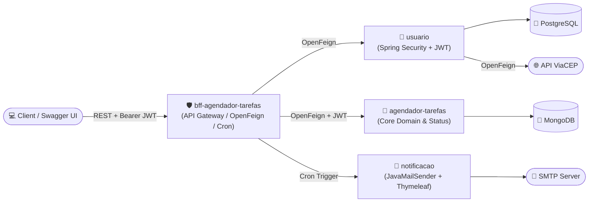

# ☕ Matheus Rodrigues Rocha Tavares
### **Backend Java Developer | Spring Boot • Microservices • RabbitMQ • PostgreSQL • Docker**

---

## 👨‍💻 Executive Summary | Resumo Executivo

> 🇺🇸 **English:**
> **Backend Java Developer** with hands-on **production experience** architecting, developing, and maintaining scalable **microservices** with **Java** and **Spring Boot**. Experienced in real-time vehicle telemetry processing (**Vision Control**), asynchronous messaging with **RabbitMQ**, relational and NoSQL databases (**PostgreSQL, MongoDB, Supabase**), **BFF (Backend For Frontend)** orchestration, **Hexagonal Architecture**, containerization with **Docker**, automated **CI/CD pipelines (GitHub Actions)**, and static code analysis with **SonarQube (90%+ coverage)**. Software Engineering undergraduate (4th semester) and **Scrum Fundamentals Certified (SFC)**.

> 🇧🇷 **Português:**
> **Desenvolvedor Backend Java** com experiência prática em **produção** na arquitetura, desenvolvimento e manutenção de **microsserviços** escaláveis utilizando **Java** e **Spring Boot**. Vivência no processamento de dados de telemetria veicular em tempo real (**Vision Control**), mensageria assíncrona com **RabbitMQ**, bancos de dados SQL e NoSQL (**PostgreSQL, MongoDB, Supabase**), arquitetura **BFF (Backend For Frontend)**, **Arquitetura Hexagonal**, conteinerização com **Docker**, pipelines de **CI/CD (GitHub Actions)** e qualidade de código com **SonarQube (90%+ de cobertura)**. Estudante do 4º período de Engenharia de Software e certificado em Scrum (**SFC**).

---

## 🛠️ Tech Stack & Architecture | Tecnologias e Arquitetura

| Domain / Domínio | Technologies & Tools |
| :--- | :--- |
| **Languages** |   |
| **Spring Ecosystem** |     |
| **Architecture & APIs** |      |
| **Messaging & Databases** |      |
| **DevOps, CI/CD & QA** |      |

---

## 🏗️ Flagship Architecture: Distributed Task Scheduling Microservices

| Microservice / Repository | Stack & Persistence | Architectural Responsibility |
| :--- | :--- | :--- |
| 🛡️ **[`bff-agendador-tarefas`](https://github.com/matheusrrtavares/bff-agendador-tarefas)** | `Java` `Spring Boot` `OpenFeign` `Swagger/OpenAPI` | Single entry point (API Gateway/BFF), centralized OpenAPI documentation, synchronous orchestration & `@Scheduled` Cron jobs. |
| 📅 **[`agendador-tarefas`](https://github.com/matheusrrtavares/agendador-tarefas)** | `Java` `Spring Data MongoDB` `MapStruct` `SonarQube` `CI/CD` | Core scheduling engine, temporal queries, status state machine & **90% code quality coverage** on SonarQube. |
| 🔐 **[`usuario`](https://github.com/matheusrrtavares/usuario)** | `Java` `Spring Security` `JWT` `PostgreSQL` `ViaCEP` | Identity management, stateless JWT authentication, JPA/Hibernate relational persistence & external ViaCEP integration. |
| 📧 **[`notificacao`](https://github.com/matheusrrtavares/notificacao)** | `Java` `Spring Boot` `JavaMailSender` `Thymeleaf` | Transactional email dispatch engine with dynamic HTML templates. |

---

## 🚀 Other Featured Backend Projects | Outros Projetos em Destaque

* 📈 **[`agregador-de-investimentos`](https://github.com/matheusrrtavares/agregador-de-investimentos):** REST API for investment portfolio management and real-time B3 stock quotes (Brapi integration) using **Spring Boot, Spring Data JPA/Hibernate, MySQL, and JUnit 5 / Mockito**.
* 🏦 **[`desafio-btgcompactual`](https://github.com/matheusrrtavares/desafio-btgcompactual):** BTG Pactual Backend Technical Challenge solution processing asynchronous order queues with **Java, Spring Boot, RabbitMQ, MongoDB, and Docker Compose**.
* ⬡ **[`arquitetura-hexagonal`](https://github.com/matheusrrtavares/arquitetura-hexagonal):** REST API applying **Hexagonal Architecture (Ports and Adapters)** and **SOLID** principles for clean domain isolation.
* 🐇 **[`mensageria-rabbitmq-springboot`](https://github.com/matheusrrtavares/mensageria-rabbitmq-springboot):** Event-driven asynchronous messaging implementation (Producers, Consumers, Exchanges, Queues & Routing Keys) with **Spring AMQP & RabbitMQ**.

---

## 💼 Production Experience | Experiência Profissional

* **Java Backend Developer Intern @ Vision Control** *(Feb 2026 – Aug 2026 | Anápolis, GO)*
  * Architected, developed, and maintained production microservices in **Java & Spring Boot** for real-time vehicle telemetry processing.
  * Integrated **PostgreSQL**, **Supabase**, asynchronous messaging with **RabbitMQ**, and containerized **Docker** environments.
  * Gathered requirements with stakeholders in **Scrum/Kanban** sprints and accelerated MVP validation with generative AI workflows.
